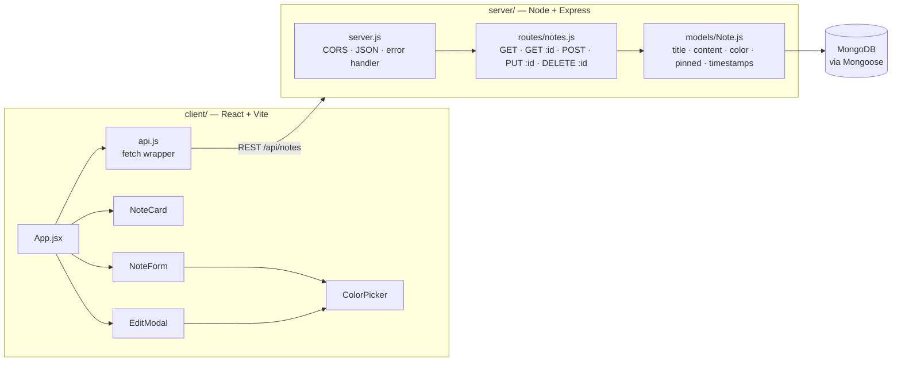
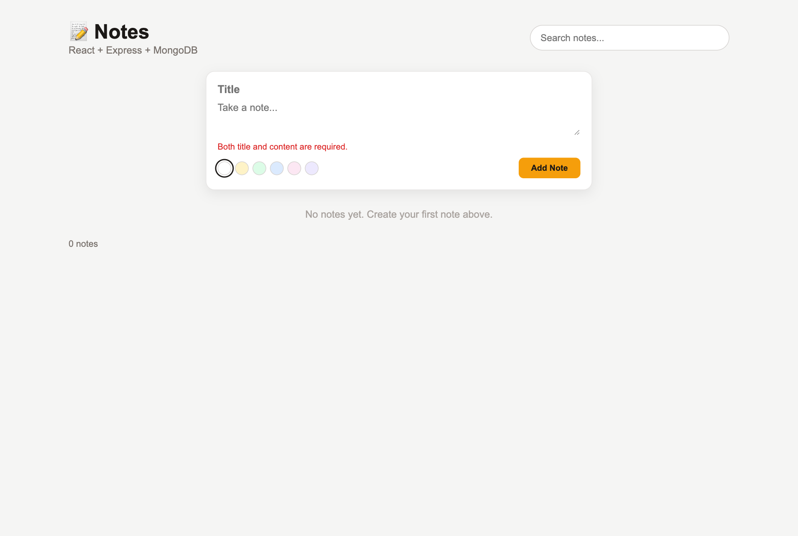
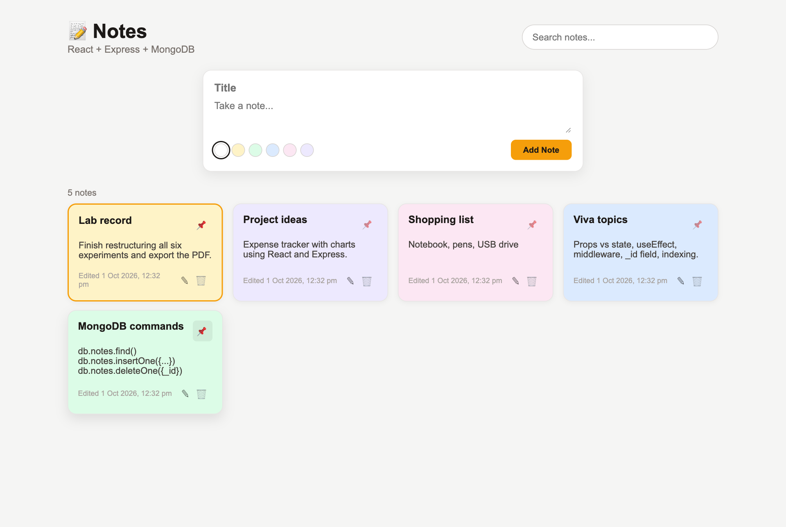
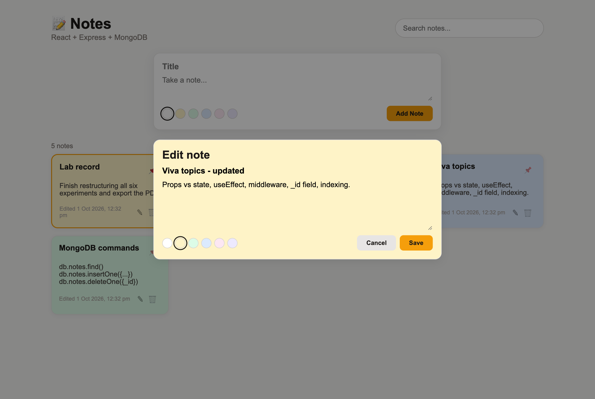
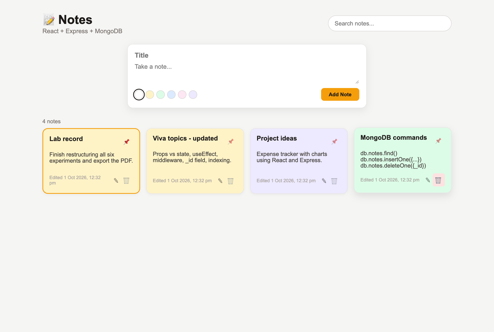
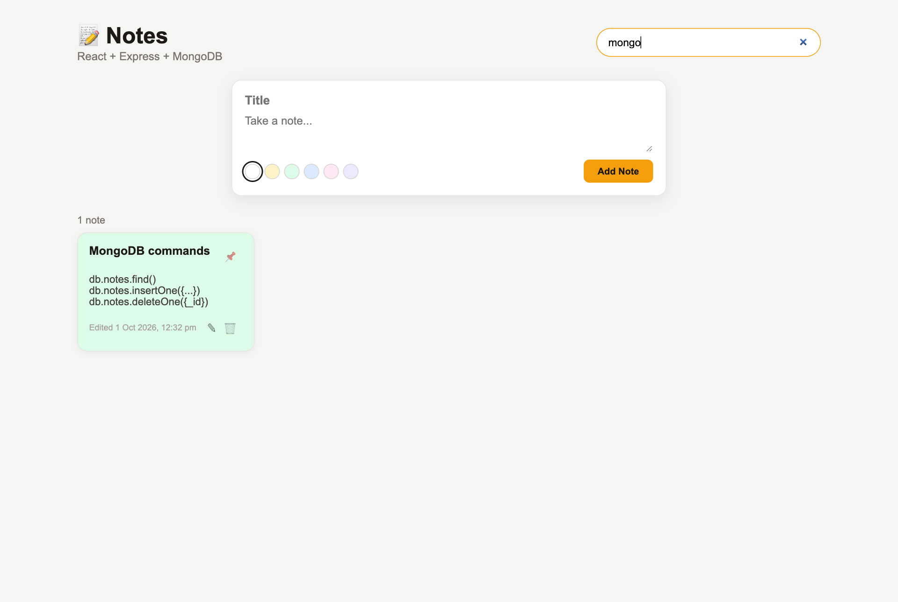
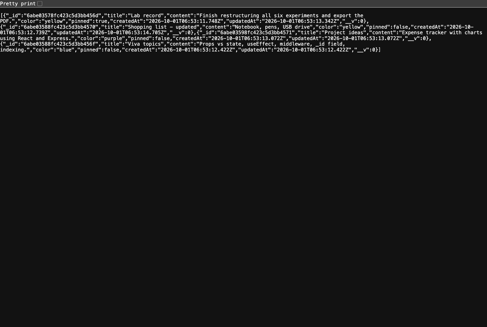
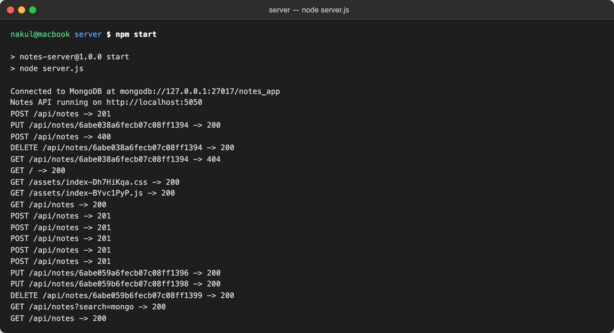
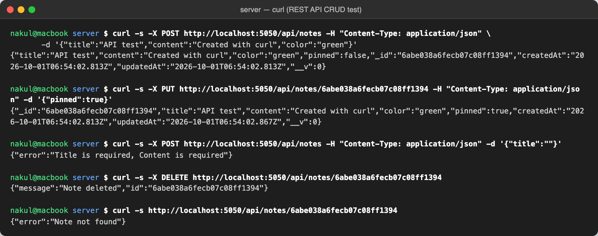
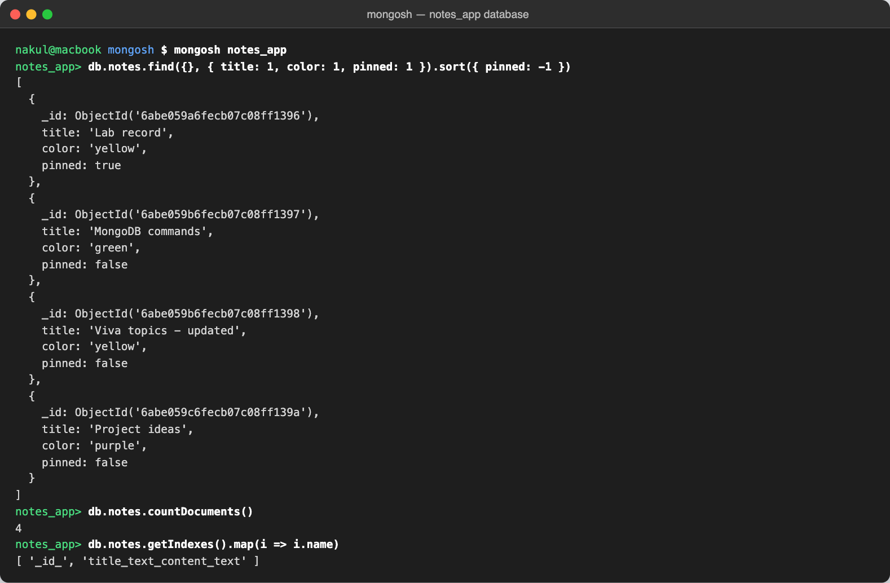

# Notes Taking Application with MongoDB

> **Application Development Laboratory (U21AD502) — Experiment 06**
> Prepared by **Nakul T (24AD068)**, Department of Artificial Intelligence and Data Science, KPR Institute of Engineering and Technology.

## Project Overview

A full-stack notes application. The back end is a REST API built with Node.js, Express and Mongoose that stores notes in a MongoDB database. The front end is a React.js single-page application that lets users create, view, search, edit, pin, colour and delete notes.

**Aim:** To develop a notes taking web application using MongoDB as a back end.

## Features

- REST API with full CRUD: GET, POST, PUT and DELETE on /api/notes
- Mongoose schema with validation (required fields, max length, allowed colours) and automatic timestamps
- Search notes by title or content (case-insensitive) with debounced input
- Create notes with a colour, edit them in a modal, pin important notes to the top and delete with confirmation
- Text index on title and content; invalid ObjectIds rejected with 400
- Central error handler converting validation errors into readable 400 responses
- Express serves the built React client, so the whole app runs from one port

## Tech Stack

| Layer | Technology |
|---|---|
| Database | MongoDB |
| ODM | Mongoose |
| Back end | Node.js, Express 5, CORS, dotenv |
| Front end | React 19, Vite, Fetch API |
| Tools | mongosh, curl |

## Architecture



It is a classic three-tier MERN layout. The React client calls the Express REST API, which validates requests and persists notes through Mongoose. Pinned notes are listed first.

## Folder Structure

```
exp06-mongodb-notes-app/
├── .gitignore
├── LICENSE
├── README.md
├── client/
│   ├── index.html
│   ├── package.json
│   ├── src/
│   │   ├── App.jsx
│   │   ├── api.js
│   │   ├── components/
│   │   │   ├── ColorPicker.jsx
│   │   │   ├── EditModal.jsx
│   │   │   ├── NoteCard.jsx
│   │   │   └── NoteForm.jsx
│   │   ├── index.css
│   │   └── main.jsx
│   └── vite.config.js
├── package.json
├── screenshots/   (output screenshots)
└── server/
    ├── .env.example
    ├── models/
    │   └── Note.js
    ├── package.json
    ├── routes/
    │   └── notes.js
    └── server.js
```

## Setup and Installation

1. Install Node.js 18+ and MongoDB Community Server (or use a MongoDB Atlas connection string).
2. Start MongoDB locally, e.g. `brew services start mongodb-community` or `mongod --dbpath <folder>`.
3. Clone the repository: `git clone https://github.com/nakultt/exp06-mongodb-notes-app.git` and `cd exp06-mongodb-notes-app`
4. Install server and client dependencies: `npm run install:all`
5. (Optional) copy `server/.env.example` to `server/.env` and change `MONGO_URI` or `PORT`.

## How to Run

**Single port (production style):**

```bash
npm run build   # builds the React client into client/dist
npm start       # starts Express + API on http://localhost:5050
```

**Development (hot reload):**

```bash
npm run dev:server   # API on http://localhost:5050
npm run dev:client   # React on http://localhost:5173 (proxies /api)
```

**API endpoints**

| Method | Endpoint | Description |
|---|---|---|
| GET | `/api/notes?search=` | List notes (optional search) |
| GET | `/api/notes/:id` | Get one note |
| POST | `/api/notes` | Create a note |
| PUT | `/api/notes/:id` | Update a note |
| DELETE | `/api/notes/:id` | Delete a note |

> Port 5050 is used because macOS reserves port 5000 for AirPlay Receiver.

## Screenshots

### 1. Validation when adding an empty note



### 2. Notes created with colours; pinned note shown first



### 3. Editing a note in the modal



### 4. Notes after an update and a delete



### 5. Searching notes by keyword



### 6. GET /api/notes response in the browser



### 7. Express server connected to MongoDB with request log



### 8. Testing the CRUD API with curl



### 9. Notes stored in the MongoDB database (mongosh)



## Result

The project was successfully developed and executed, and the output was verified.

## Author

**Nakul T** — 24AD068 · B.Tech Artificial Intelligence and Data Science · [github.com/nakultt](https://github.com/nakultt)
